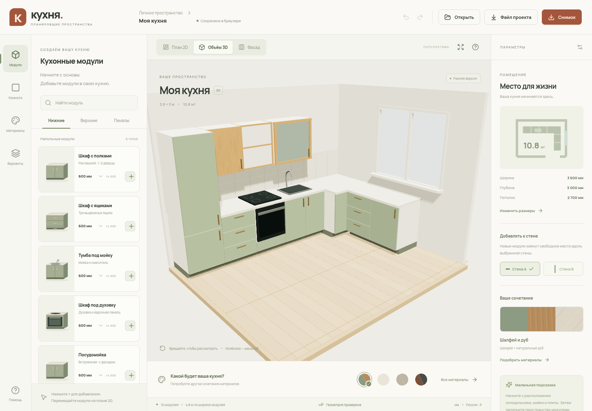

# Кухня — веб-планировщик

Первый прототип приложения для самостоятельной сборки и визуализации кухни. Ориентация: Россия; интерфейс на русском. Производственные выгрузки, приём заказов и расчёт стоимости готовой кухни в задачу не входят.



## Запуск

Требуется Node.js 22.12+ и npm.

```bash
npm ci
npm run dev
```

Vite напечатает адрес локального приложения. Работает как статическое веб-приложение; серверная часть и аккаунт не нужны.

```bash
npm test       # геометрия и проверка импортируемых проектов
npm run build # TypeScript + production-сборка в dist/
npm run preview
```

## Что уже работает

- Размеры прямоугольной комнаты; окно на стене B с настройкой ширины и отступа; входной проём.
- Примеры прямой и угловой кухни; возможность очистить пример и начать с нуля.
- 11 типов модулей с размерными рядами: нижние шкафы, ящики, мойка, духовка, посудомойка, угол, навесные шкафы, витрина, полки, холодильник и пенал.
- Добавление к стенам A/B с поиском свободного места.
- 2D-план с перетаскиванием, привязкой к стенам и соседним модулям; виды 3D и фасад.
- Выбор, поворот, изменение ширины, координат, материала отдельного модуля и стороны петель; дублирование и удаление.
- Проверка пересечений с учётом высоты модулей, выхода за стены и превышения потолка.
- Общие материалы нижнего и верхнего ярусов, столешницы; ручки, пол, стены, 4 готовые палитры.
- Отмена/повтор, автосохранение, до 8 локальных вариантов.
- Экспорт/импорт JSON с проверкой структуры; PNG для 3D, SVG для плана и фасада.
- Адаптивный интерфейс для небольших экранов.

## Управление

На плане перетаскивайте модуль мышью или касанием. Выбранный модуль можно двигать стрелками с шагом 50 мм, с Shift — 100 мм. Delete удаляет модуль, Escape снимает выделение. Ctrl/Cmd+Z — отмена, Ctrl/Cmd+Shift+Z — повтор. В 3D перетаскивание вращает камеру, колёсико меняет масштаб.

## Важные границы прототипа

Модули и палитра универсальные, не привязаны к артикулам производителя. Цвета и процедурные текстуры иллюстративные. Актуальное наличие и цены не подключены. Фартук пока фиксирован; столешницы отрисовываются по модулям. Текущая 3D-сцена — интерактивный эскиз, не фотореалистичный рендер.

Комната прямоугольная. Окно расположено на стене B, подоконник и высота окна пока фиксированы. Положение входного проёма фиксировано. Открывание дверец, столкновения с проёмами, инженерные коммуникации, проходы и монтажные зазоры техники пока не проверяются. Автоматическая расстановка работает вдоль стен A/B; свободное перемещение и поворот доступны на плане.

Проекты хранятся в localStorage этого браузера. Для переноса на другое устройство используйте JSON. Серверного хранения и совместного доступа пока нет.

## Структура

```text
src/model.ts       — единая модель, каталог, геометрия, импорт
src/App.tsx        — интерфейс, история, локальные проекты, экспорт
src/Scene.tsx      — Three.js, процедурные материалы, выбор объектов
src/Plan.tsx       — SVG-план, перенос модулей и фасады
src/styles.css    — адаптивное оформление
tests/            — правила геометрии и формат проекта
docs/             — продуктовый план и каталог материалов
```

План, фасад и 3D используют один Project. Все геометрические значения модели — в миллиметрах; в Three.js конвертируются в метры. Центры модулей заданы от верхнего левого угла плана. Поворот 0° направляет фасад внутрь от стены A, 270° — внутрь от стены B.

Дальнейший объём и источники: [план разработки](docs/ROADMAP.md), [материалы](docs/MATERIALS.md).

Шрифт Manrope включён локально под SIL Open Font License; лицензия находится в `public/fonts/OFL.txt`. Работа приложения не зависит от загрузки внешних шрифтов, моделей и текстур.
